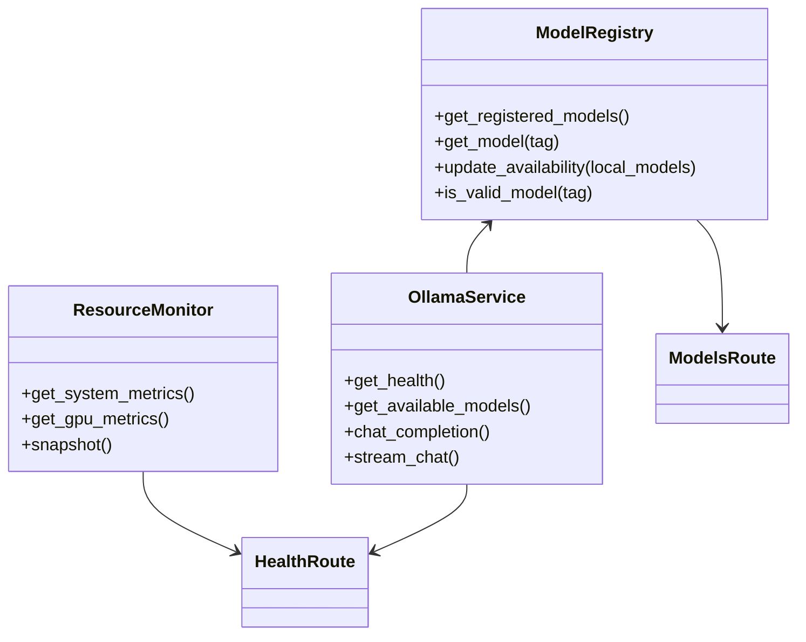

# System Architecture

## 1. Architectural Philosophy
*Local SLM Laboratory* is designed around three principles:
1. **Total Local Execution:** No cloud inference, no external API keys, zero private data leakage.
2. **Shared Service Abstraction:** Chatbot, RAG, and Database Assistant all share the same Model Registry and Ollama Service rather than duplicating model clients.
3. **Hardware-Aware Governance:** Sequential inference and memory governance optimized for 6GB VRAM laptops (NVIDIA RTX 4050).



## 2. Directory Structure
```
SML/
├── backend/
│   ├── app/
│   │   ├── main.py              # FastAPI app & lifespan initialization
│   │   ├── core/                # Config, logging, exceptions
│   │   ├── api/                 # Route handlers & Pydantic schemas
│   │   ├── services/            # Model registry, Ollama client, monitoring
│   │   └── db/                  # SQLAlchemy models, sessions, seeder
│   ├── tests/                   # Automated pytest suites
│   ├── storage/                 # SQLite databases, uploads, ChromaDB
│   ├── requirements.txt         # Pinned Python dependencies
│   └── .env                     # Environment variables
├── frontend/
│   ├── src/
│   │   ├── app/                 # Root App component and routing
│   │   ├── components/          # Sidebar, Header, Status Banner
│   │   ├── pages/               # Dashboard, Chat, RAG, Database, Benchmarks
│   │   ├── services/            # Typed HTTP API client
│   │   └── types/               # Shared TypeScript interfaces
│   ├── package.json
│   ├── tailwind.config.js
│   └── vite.config.ts
└── docs/                        # ADRs, Execution Flows, Architectural guides
```

## 3. Database Isolation
- **Application Database (`storage/app_data.db`):** Contains `conversations`, `messages`, `documents`, `document_chunks`, `benchmark_runs`, `benchmark_results`, and `database_assistant_logs`.
- **Demo Database (`storage/demo_ecommerce.db`):** Dedicated synthetic database containing `customers`, `products`, and `orders`. Completely isolated from internal app tables so that NL-driven mutations can be wiped or tested safely without altering system data.
