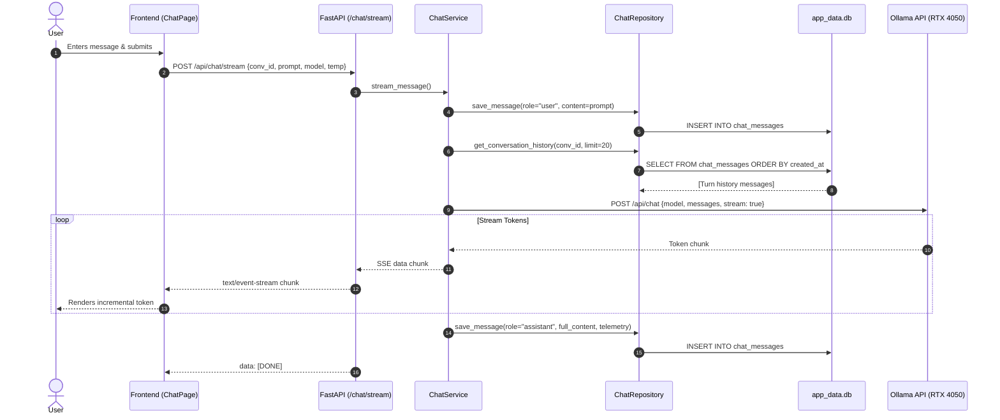
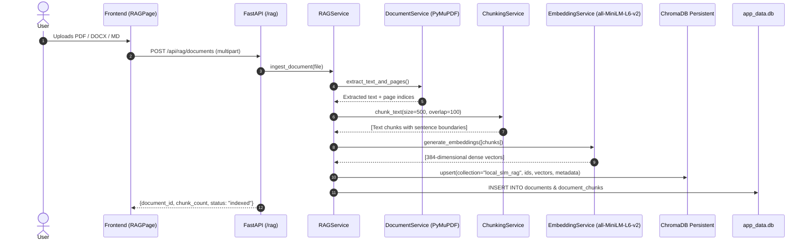
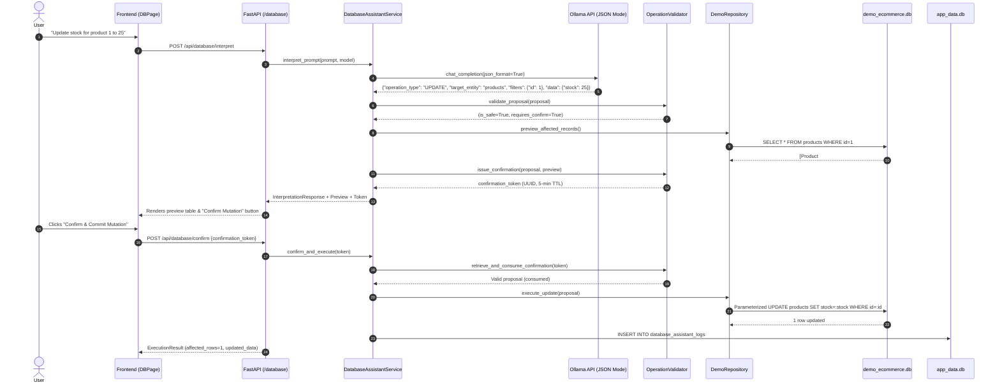
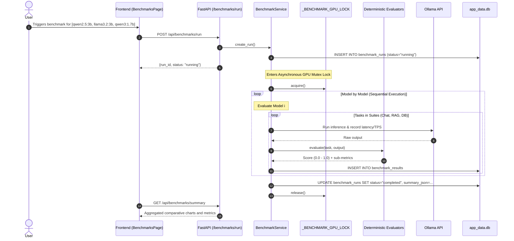

# Local SLM Laboratory: Data Flow & Subsystem Architecture

This document diagrams how data travels through each subsystem of the laboratory, from user input to model inference and persistent storage.

---

## 1. Subsystem 1: Conversational Chatbot Flow

---

## 2. Subsystem 2: Document RAG Ingestion & Grounded Retrieval

---

## 3. Subsystem 3: Controlled Database Assistant & Two-Phase Mutation

---

## 4. Subsystem 4: Sequential Benchmark Engine

