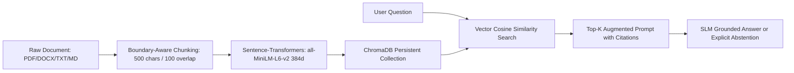
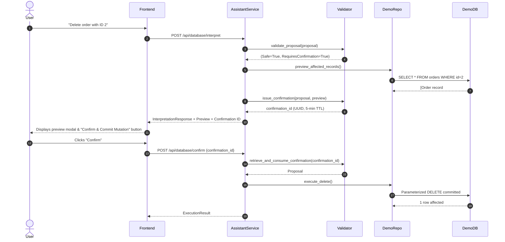

# Local SLM Laboratory: Educational Full-Stack & AI Engineering Guide

Welcome to the **Local SLM Laboratory** codebase. This guide serves as a technical mentoring manual to help you understand every foundational concept, architectural pattern, and implementation detail used across this project.

---

## Table of Contents
1. [Core Python Full-Stack Concepts](#1-core-python-full-stack-concepts)
2. [Asynchronous Programming & Concurrency](#2-asynchronous-programming--concurrency)
3. [FastAPI Architecture & Dependency Injection](#3-fastapi-architecture--dependency-injection)
4. [SQLAlchemy 2.0 ORM & Dual Database Isolation](#4-sqlalchemy-20-orm--dual-database-isolation)
5. [Local Small Language Models & Ollama Integration](#5-local-small-language-models--ollama-integration)
6. [Retrieval-Augmented Generation (RAG) Deep Dive](#6-retrieval-augmented-generation-rag-deep-dive)
7. [Natural-Language Relational Database Assistant](#7-natural-language-relational-database-assistant)
8. [Unified Benchmark Engine & Telemetry](#8-unified-benchmark-engine--telemetry)
9. [Debugging & Independent Extension](#9-debugging--independent-extension)

---

## 1. Core Python Full-Stack Concepts

### 1.1 Type Annotations and Strict Typing
Python is dynamically typed at runtime, but modern production full-stack Python uses **type annotations** (PEP 484) to eliminate entire classes of bugs before runtime.

In this project, examine `backend/app/api/schemas/database_ops.py`:
```python
from typing import List, Dict, Any, Optional, Literal
from pydantic import BaseModel, Field

class CRUDOperationProposal(BaseModel):
    operation_type: Literal["SELECT", "INSERT", "UPDATE", "DELETE"]
    target_entity: Literal["customers", "products", "orders"]
    filters: Dict[str, Any] = Field(default_factory=dict)
    fields: Optional[List[str]] = None
    limit: Optional[int] = Field(10, ge=1, le=50)
```
- `Literal[...]`: Restricts strings to only allowlisted values at validation time.
- `Optional[T]`: Equivalent to `Union[T, None]`.
- `Field(default_factory=dict)`: Guarantees that every new instance gets a fresh empty dictionary rather than sharing a mutable default instance.

### 1.2 Pydantic V2 Models vs Dicts
Instead of parsing raw JSON into untyped Python dictionaries (`data["operation"]`), we parse into Pydantic models:
```python
parsed = CRUDOperationProposal.model_validate(json_dict)
```
**Benefits:**
- **Coercion & Validation:** Strings like `"10"` automatically coerce to integer `10` where typed.
- **Fail Fast:** If required fields are missing, Pydantic immediately raises a `ValidationError` with exact field paths, preventing downstream `KeyError` crashes.
- **Serialization:** `model.model_dump()` converts cleanly to dicts, and `model.model_dump_json()` outputs JSON strings.

---

## 2. Asynchronous Programming & Concurrency

### 2.1 The Python Event Loop & `async / await`
Traditional synchronous Python (`def`) blocks the thread whenever an I/O operation occurs (e.g., waiting for an HTTP response from Ollama or reading a file). In contrast, `async def` functions run cooperatively inside a single-threaded **event loop** (`asyncio`).

When Python encounters `await ollama_service.chat_completion(...)`:
1. The function pauses execution.
2. The event loop switches to process other incoming HTTP requests, WebSocket messages, or telemetry pings.
3. Once the socket receives data, the event loop resumes our function right where it stopped.

### 2.2 Hardware Arbitration via `asyncio.Lock`
In `backend/app/services/benchmark_service.py`, we manage an NVIDIA RTX 4050 GPU with **6GB of VRAM**. Attempting to load two 3B models simultaneously would cause a CUDA Out-of-Memory (OOM) crash:
```python
_BENCHMARK_GPU_LOCK = asyncio.Lock()

async def _execute_benchmark_suite(self, run_id, model_tags, suites):
    async with _BENCHMARK_GPU_LOCK:
        # Only ONE benchmark run and ONE model evaluates at any given moment
        for model in model_tags:
            ...
```
`async with _BENCHMARK_GPU_LOCK` acts as a mutual exclusion gate: if another benchmark request arrives while one is running, it queues politely rather than overwhelming GPU memory.

---

## 3. FastAPI Architecture & Dependency Injection

### 3.1 Declarative Routing and Dependency Injection (`Depends`)
Look at `backend/app/api/routes/database_assistant.py`:
```python
@router.get("/schema", response_model=DatabaseSchemaResponse)
async def get_database_schema(db: Session = Depends(get_demo_db)):
    ...
```
**How `Depends` works:**
1. FastAPI calls the generator function `get_demo_db()` from `app/db/session.py`.
2. `get_demo_db()` creates a database session, yields it to our route handler, and waits.
3. Our route executes using `db`.
4. In the `finally` block of `get_demo_db()`, `db.close()` runs automatically, preventing connection leaks even if an unhandled exception occurs!

### 3.2 Lifespan Management
In `backend/app/main.py`:
```python
@asynccontextmanager
async def lifespan(app: FastAPI):
    # Runs before accepting incoming HTTP requests
    settings.ensure_directories()
    init_databases()
    yield
    # Runs during graceful server shutdown
    logger.info("Server shutting down.")
```
This replaces deprecated `@app.on_event("startup")` hooks with clean, modern context management.

---

## 4. SQLAlchemy 2.0 ORM & Dual Database Isolation

### 4.1 Why Dual Databases?
The laboratory maintains two physically separate SQLite files:
1. `app_data.db`: Stores application metadata (chat sessions, message history, uploaded documents, Chroma chunk references, benchmark runs, and audit logs).
2. `demo_ecommerce.db`: An isolated database containing synthetic eCommerce tables (`customers`, `products`, `orders`).

**Architectural Rationale:**
The Natural-Language Database Assistant allows users and SLMs to issue `INSERT`, `UPDATE`, and `DELETE` instructions. If this executed against the application's primary database, an errant model hallucination could delete user conversation history or drop benchmark tables! By isolating demo data in a separate engine, the application is physically protected.

### 4.2 SQLAlchemy 2.0 `select()` Syntax
In SQLAlchemy 2.0, legacy `db.query(Model).filter(...)` is modernized to standard SQL-like `select()`:
```python
from sqlalchemy import select

stmt = select(BenchmarkRun).where(BenchmarkRun.status == "completed").order_by(desc(BenchmarkRun.completed_at))
runs = db.scalars(stmt).all()
```
`db.scalars(stmt).all()` returns the list of model instances cleanly.

---

## 5. Local Small Language Models & Ollama Integration

### 5.1 What are Small Language Models (SLMs)?
SLMs are neural networks with parameter counts generally under 4 billion. While frontier models (GPT-4, Claude 3.5 Sonnet) operate in cloud data centers with hundreds of billions of parameters, SLMs can run **100% locally** on consumer laptops with dedicated GPUs (such as an NVIDIA RTX 4050 6GB).

### 5.2 Real-World Parameter Counts (Transparency Rule)
Model marketing tags often round numbers:
- **`qwen2.5:3b`**: Actually contains **3.09 billion** parameters.
- **`llama3.2:3b`**: Actually contains **3.21 billion** parameters.
- **`qwen3:1.7b`**: Actually contains **1.70 billion** parameters.

Our UI and backend explicitly disclose these actual parameter counts to foster real engineering rigor.

### 5.3 Streaming via Server-Sent Events (SSE)
In `backend/app/api/routes/chat.py`, token streaming uses HTTP Server-Sent Events (`text/event-stream`):
```python
async def token_generator():
    async for chunk in ollama_service.stream_chat(model, messages, system_prompt):
        yield f"data: {json.dumps(chunk)}\n\n"
    yield "data: [DONE]\n\n"

return StreamingResponse(token_generator(), media_type="text/event-stream")
```
The client receives tokens incrementally as they are generated by the GPU, providing instantaneous visual feedback and a low Time-To-First-Token (TTFT).

---

## 6. Retrieval-Augmented Generation (RAG) Deep Dive

### 6.1 The 4 Stages of Local RAG


### 6.2 Semantic Chunking
In `backend/app/services/chunking_service.py`, we do not cut text blindly at fixed character offsets. Instead, we split by paragraphs and sentences first:
- If a sentence fits within the `chunk_size` (e.g. 500 characters), it remains intact.
- An overlap (e.g. 100 characters) prepends the trailing context of the previous chunk to maintain coherence across boundaries.

### 6.3 Grounded Citations & Abstention
SLMs are prone to hallucinating when asked questions outside their training data or context window. Our RAG system implements two strict guardrails:
1. **Mandatory Citations:** The prompt instructs the model to cite sources: `[Document: filename, Page: X]`.
2. **Explicit Abstention:** If the retrieved passages do not contain enough evidence, the model is instructed to output `"INSUFFICIENT EVIDENCE"` rather than guessing.

---

## 7. Natural-Language Relational Database Assistant

### 7.1 The Danger of Raw SQL Generation
Giving an SLM the ability to generate and execute raw SQL strings (`"SELECT * FROM ...; DROP TABLE users;"`) introduces severe SQL injection, schema corruption, and hallucination risks.

### 7.2 Structured Tool Proposal Architecture
Instead of generating SQL strings, the SLM is instructed to act as a structured planner and produce a Pydantic-validated JSON object (`CRUDOperationProposal`):
```json
{
  "operation_type": "UPDATE",
  "target_entity": "products",
  "filters": {"id": 1},
  "data": {"stock": 25},
  "explanation": "Update stock for product 1"
}
```

### 7.3 Two-Phase Confirmation Guardrail


---

## 8. Unified Benchmark Engine & Telemetry

### 8.1 Standardized Datasets
Located in `backend/app/evaluation/datasets/`:
1. `chatbot_benchmarks.json`: Evaluates instruction-following, code generation, reasoning, roleplay, and JSON formatting.
2. `rag_benchmarks.json`: Evaluates factoid recall, citation adherence, and explicit abstention on unanswerable questions.
3. `database_benchmarks.json`: Evaluates entity matching, filter correctness, confirmation triggers, and safety policy rejections.

### 8.2 Deterministic Evaluators
Rather than using an expensive, nondeterministic LLM-as-a-judge, our evaluators (`chat_evaluator.py`, `rag_evaluator.py`, `database_evaluator.py`) evaluate programmatically:
- **Code Execution:** Executes generated Python code inside an isolated namespace to verify test assertions pass.
- **JSON Schema Validation:** Verifies that required keys are present and data types match.
- **Regex Citation Verification:** Checks for valid citation tags `[Document: ..., Page: ...]`.
- **Safety Enforcement:** Confirms that malicious or malformed requests were rejected by policy.

---

## 9. Debugging & Independent Extension

### 9.1 How to Add a New Table to the Demo Database
1. Define the model in `backend/app/db/models.py` inheriting from `DemoBase`.
2. Add allowlisted columns to `SCHEMA_ALLOWLIST` in `backend/app/services/operation_validator.py`.
3. Register the model in `MODEL_MAP` in `backend/app/db/repositories/demo_repository.py`.
4. Add seed data to `backend/app/db/seed.py`.
5. Run `pytest tests/test_database_assistant.py` to verify!

### 9.2 How to Add a New Benchmark Test Case
Open `backend/app/evaluation/datasets/chatbot_benchmarks.json` or `database_benchmarks.json` and append your test case:
```json
{
  "task_id": "custom_filter_09",
  "category": "numeric_filter",
  "prompt": "Find all products with stock less than 20",
  "expected_operation": "SELECT",
  "expected_entity": "products",
  "expected_filters": {"stock_lt": 20},
  "requires_confirmation": false,
  "should_pass_safety": true
}
```
The benchmark engine will automatically include it on the next run!
